# SubSlash — the nerve to cancel

<a href="README.md">한국어</a> | <b>English</b>

  

> Is that subscription leaving your account every month really worth it?

**SubSlash** shows a subscription's price not as "₩17,000 a month" but as a **cost per use** — "₩4,250 each time you
watch" — and once you've decided to cancel, helps you all the way through cancelling.

- Web: [www.subslash.me](https://www.subslash.me) — use it right away, no sign-up needed.
- Android app: currently in closed testing. The store link will go here once it's publicly released.

### Intro video

https://github.com/user-attachments/assets/0236c964-fc1e-4c15-ba16-9012d489e57e

If the video doesn't show, [download it here (MP4, 8 MB)](docs/media/subslash-intro.mp4).

> Every screen in this README is a capture of the Android app taken with sample data (October 23, 2026).

## Who it's for

- You're not sure how many subscriptions you have or how much leaves your account each month
- Netflix, YouTube Premium, Coupang WOW… you aren't sure you actually use them all
- You wanted to cancel but couldn't find where the cancel button is
- You signed up for a free trial and missed the day it ended

## How to use it

### 1. Add your subscriptions

Pick the services you use from the list. For services with several plans (Netflix, etc.) you choose your own plan, and
you can note the billing day, payment method and the account you signed up with. If adding them one by one is a chore:

- **Find in payment emails** — finds subscription candidates from payment emails in your Gmail. Once logged in, you can
  also have it check automatically every two weeks.
- **Paste a payment text** — paste or share a card payment text message or receipt and it reads it in.
- **Find from phone usage** (Android app) — if there's a streaming app you use often but haven't added, it asks "Are you
  subscribed?". It only asks; it never adds anything on its own.
- **Try with samples** — see the screens with sample subscriptions before adding your own. Samples never mix with your
  real records.

  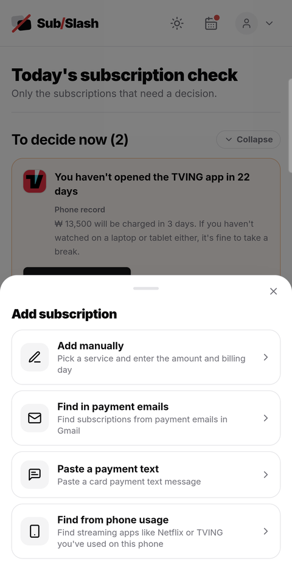
  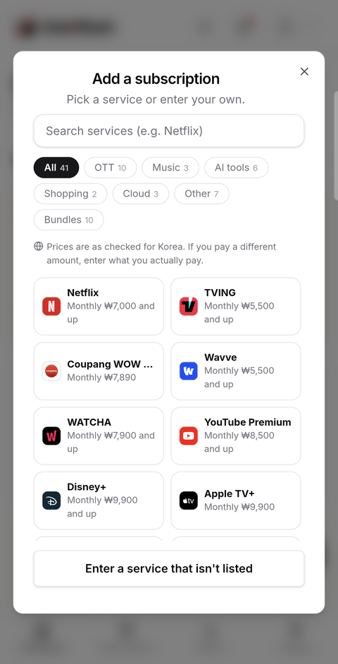
  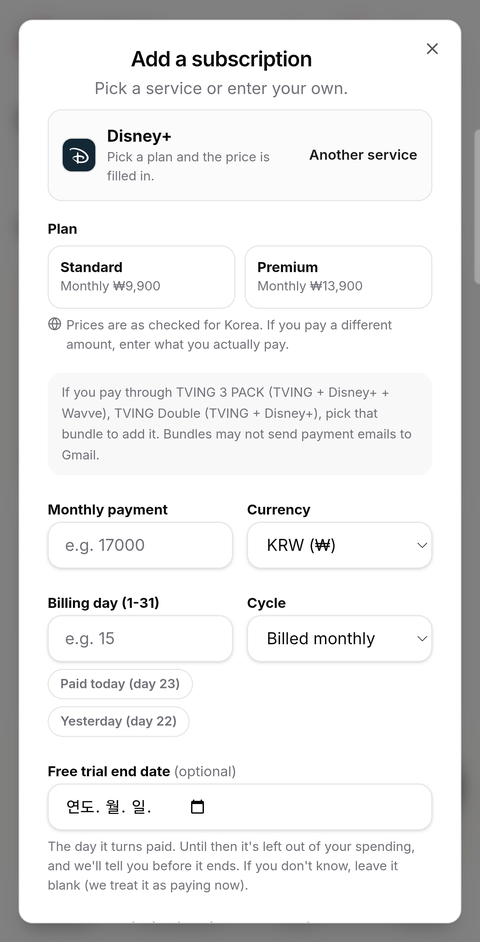
  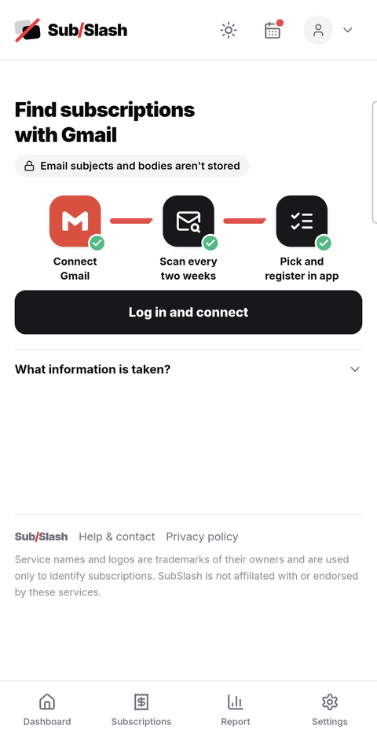

Add subscription · Pick a service · Pick a plan · Find subscriptions with Gmail

### 2. Check in on how much you used it

Answer "How many times did you use it in the last 30 days?" and you get the cost per use, with a color telling you
whether it's good value (green), so-so (yellow) or pricey (red). Each service is measured in its own unit — times
watched for streaming, benefits received for memberships, storage used for cloud storage.

If counting by hand is hard, there are ways to have it counted for you.

- The **Android app**, once you turn on 'Usage access', records how long and how often you used your subscription apps
  on the phone and fills in the check-in. It doesn't write a number until the record covers a full 30 days — writing a
  few days' worth as "in the last 30 days" would lead to the wrong call.
- **Google One** reads your Google account's storage usage and fills in what percentage you use.
- **AI subscriptions like Claude and ChatGPT** count the days you used them from the Claude Code, Codex, Cursor and
  Antigravity records on your PC or a claude.ai conversation export, and also show what the same usage would have cost
  through the API. Files are read only inside your browser.

  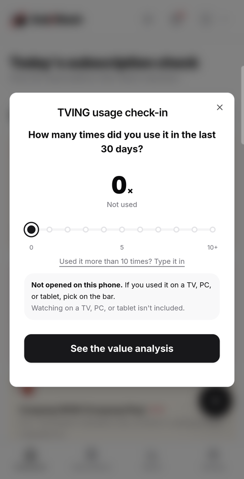
  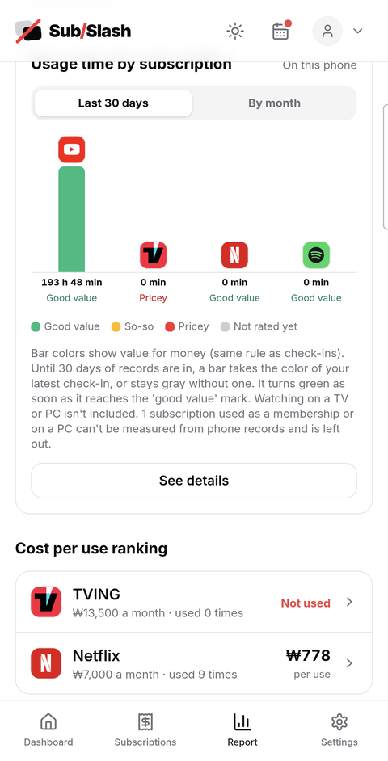

Check-in · Usage time by subscription from phone records

### 3. See what needs doing on the dashboard

The dashboard shows the subscriptions that need your attention first.

- **Charged after you cancelled** — if a payment email arrives for a subscription you cancelled, it goes to the very top.
- **The charge was different** — if the amount in a payment email differs from the amount you registered, the two numbers
  are shown side by side.
- **Your free trial ends soon** — you're told from 7 days before it ends. A subscription still in its trial isn't money
  you're paying yet, so it's left out of your spending total.
- **Payment coming up / time to check in** — subscriptions with a billing day approaching, and ones you haven't checked
  in on for a while.

  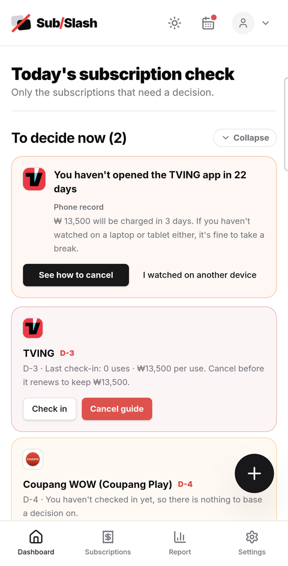
  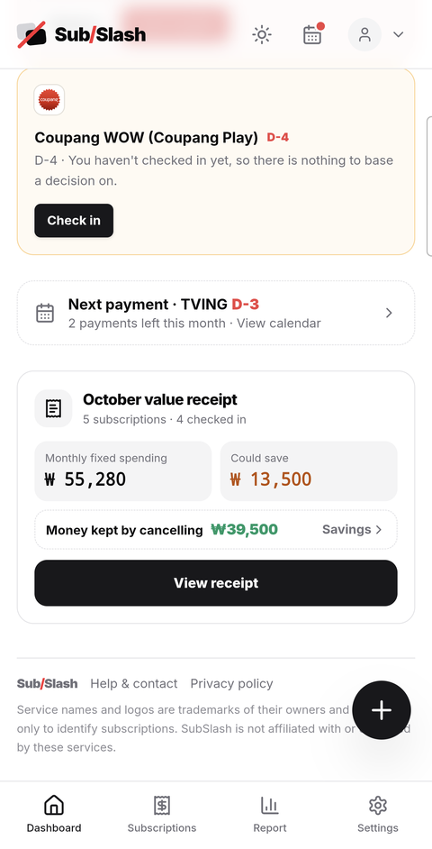
  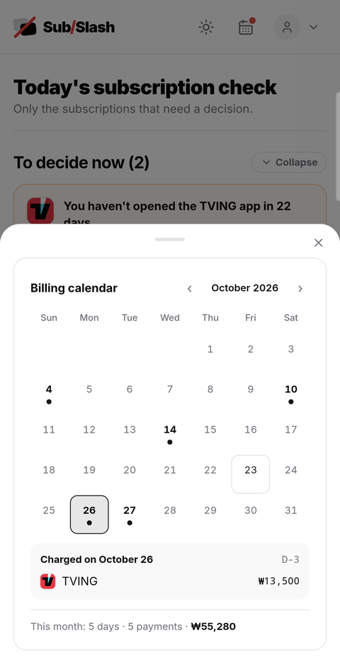

Today's subscription check · Monthly value receipt · Billing calendar

### 4. Cancel

Once you decide to cancel, it walks you through each service's cancellation step by step. It tells you whether a link
goes straight to the cancel screen or only to the service's home page — so you don't open the home page and think
you've cancelled. If you noted which account you signed up with, it reminds you "Log in with this account to see the
cancel button".

When you record a cancellation, the money you'll no longer pay adds up under **Money kept**, which you can share with
friends.

  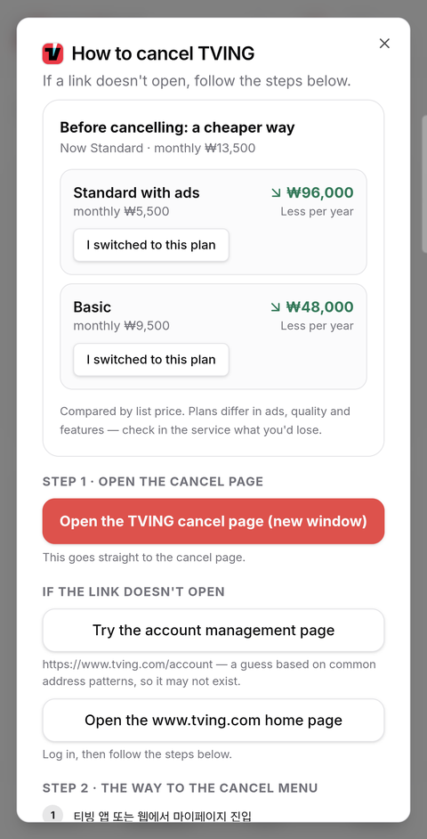
  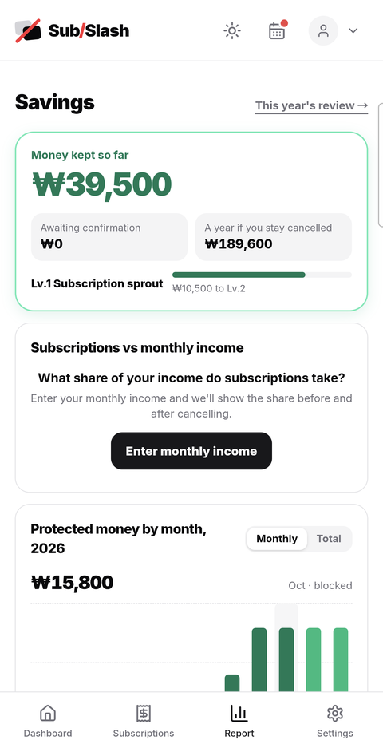

Cancel guide · Money kept

### 5. Read your report

The **Report** tab at the bottom shows

- what you spend on subscriptions per month and per year, and the cost-per-use ranking
- usage by subscription (time used on the phone in the app, recent check-ins on the web)
- whether you might be **paying twice for the same service** through a bundle and a separate subscription
- **subscription receipts and the year in review** — save what you paid this month or this year as a receipt-style
  image (in several designs)

In **Ask your report**, ask things like "How much am I spending on OTT?" or "Which subscription is the biggest waste?"
and get an answer right away. (Questions are best understood in Korean.)

  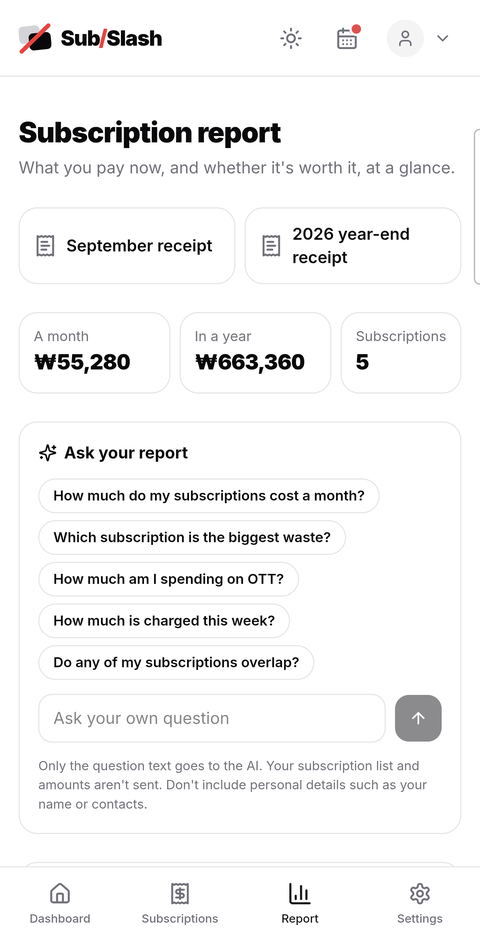
  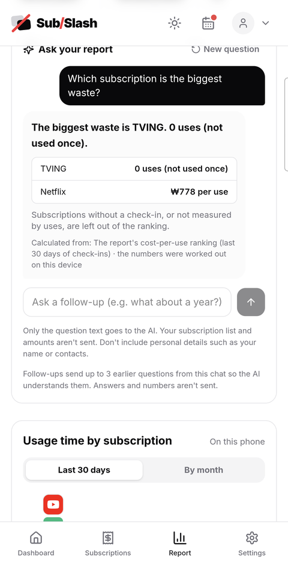
  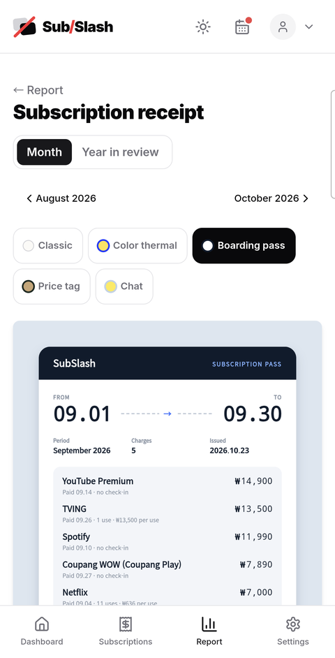

Subscription report · Ask your report · Subscription receipt

### Billing day reminders

- Web: press **Add billing days to Google Calendar** below your subscription list and billing-day events appear in your
  own Google Calendar. The event notes include the cancel link, so you can go cancel straight from your calendar.
- App: a local notification on your phone reminds you a few days before a payment. No login needed.

## What we do to keep the numbers right

- **Shared subscriptions count your share** — cancelling a family plan split four ways only saves you a quarter. Spending
  and savings are calculated from the share you actually pay.
- **Foreign services at today's rate** — dollar subscriptions are converted to won at the official exchange rate each
  business day (or a rate you set yourself). For services whose listed price excludes tax, the amount shown includes tax.
  Receipts of past payments use the exchange rate of each payment date.
- **If we don't know, we say so** — an annual subscription without a known billing month shows "Billing month not set"
  instead of a made-up date. A payment we can't identify stays an "Unknown payment" rather than getting a plausible name.

## Where is my data stored?

- **On your device by default.** Without logging in, your subscription records stay only in your browser (or on your
  phone in the app) and never go to the server.
- **If you log in**, your records are saved to your account and you can see the same records on several devices. You can
  sign up with email and a username or log in with Google, Kakao or Naver. Auto-sync can be turned off per device.
- **Find in payment emails** has a script running in your own Google account read the emails. The SubSlash server keeps
  no email subjects or bodies — only the subscription candidates it found, briefly.
- **Ask your report** sends only the question text to the AI. Your subscription list and amounts are not sent; the
  numbers are calculated on your device. Common questions are answered on the device without going through the AI.
- **Phone usage records** never leave the phone.
- You can export a backup file or delete all your records from Settings at any time.

Details are in the [privacy policy](https://www.subslash.me/privacy) (the Korean version prevails if the two differ).
For questions, check [Help](https://www.subslash.me/help) or email `privacy@subslash.me`.

## Also

- **Languages**: Korean, English, Chinese (Simplified), Japanese, Vietnamese, French, Spanish, German and Portuguese.
  Prices are in won as checked in Korea.
- **Theme**: choose auto, light or dark from the top bar.
- You must be 14 or older to sign up.
- Payment reminder emails and the calendar subscription feed (webcal) were retired in October 2026. Use the Google
  Calendar option above or the app's notifications for billing days.

## For developers

How to run and deploy the code is in the [development guide](docs/DEVELOPMENT.md), and the rules to follow when changing
code are in [CLAUDE.md](CLAUDE.md) (both in Korean).

## License

The source code is [MIT](LICENSE).

**Service logos and names are not covered by the MIT license.** The app icons in `apps/web/public/logos/`, the brand
glyphs in `apps/web/lib/service-logos.ts`, and the service names shown in the app are trademarks of their respective
owners and are used only so users can recognize the services they subscribe to. Details and how to request removal are
at the bottom of `LICENSE`.
