# SubSlash — 구독, 끊을 용기

  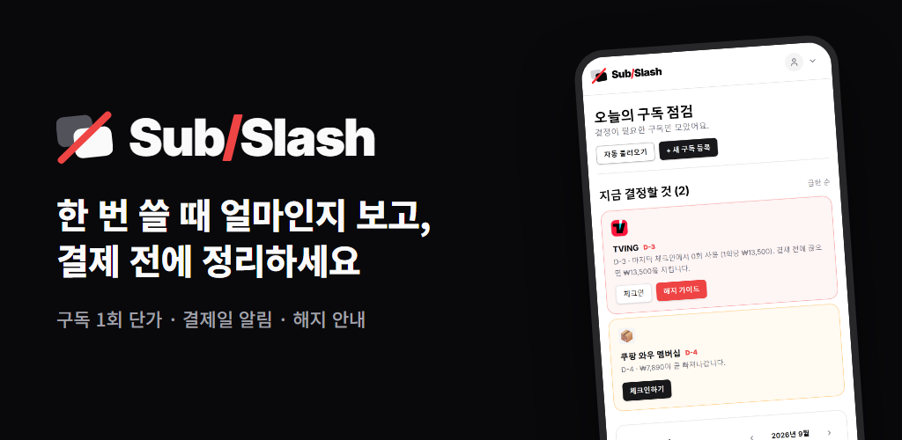

> 매달 빠져나가는 구독료, 정말 그만한 가치가 있을까요?

**SubSlash**는 구독료를 "한 달 17,000원"이 아니라 **"한 번 볼 때 4,250원"** 처럼 1회 사용 단가로 보여 주고,
해지하기로 마음먹었다면 해지까지 돕는 서비스입니다.

- 웹: [www.subslash.me](https://www.subslash.me) — 회원가입 없이 바로 쓸 수 있습니다.
- 안드로이드 앱: 지금은 비공개 테스트 중입니다. 공개 출시하면 이곳에 스토어 주소를 적습니다.

### 소개 영상

**[▶ SubSlash 소개 영상 보기 (MP4, 9MB)](docs/media/subslash-intro.mp4)** — 무엇을 하는 서비스인지 짧게 보여 줍니다.

> 이 README의 화면은 모두 샘플 데이터로 찍은 안드로이드 앱 캡처입니다(2026년 10월 23일).

## 이런 분께 맞아요

- 구독이 몇 개인지, 한 달에 얼마가 나가는지 정확히 모르겠다
- 넷플릭스·유튜브 프리미엄·쿠팡 와우… 다 쓰고 있는 건지 확신이 없다
- 해지하려고 보니 해지 버튼이 어디 있는지 찾기 어렵다
- 무료 체험을 신청해 놓고 끝나는 날을 놓친 적이 있다

## 쓰는 방법

### 1. 구독 등록하기

쓰는 서비스를 목록에서 고르면 됩니다. 요금제가 여럿인 서비스(넷플릭스 등)는 내가 쓰는 요금제를 직접 고르고,
결제일·결제 수단·가입한 계정을 적어 둘 수 있습니다. 하나씩 적기 번거롭다면:

- **Gmail에서 찾기** — 메일함의 결제 메일로 구독 후보를 찾아 줍니다. 로그인하면 2주마다 자동으로 확인하게 할 수도
  있습니다.
- **결제 문자 붙여 넣기** — 카드 결제 문자나 영수증을 붙여 넣거나 공유하면 읽어 들입니다.
- **폰 사용 기록에서 찾기**(안드로이드 앱) — 등록하지 않았는데 자주 쓰는 OTT 앱이 있으면 "구독 중인가요?"라고
  물어봅니다. 묻기만 하고 마음대로 등록하지 않습니다.
- **샘플로 둘러보기** — 등록 전에 샘플 구독으로 화면을 먼저 볼 수 있습니다. 샘플은 내 기록에 섞이지 않습니다.

  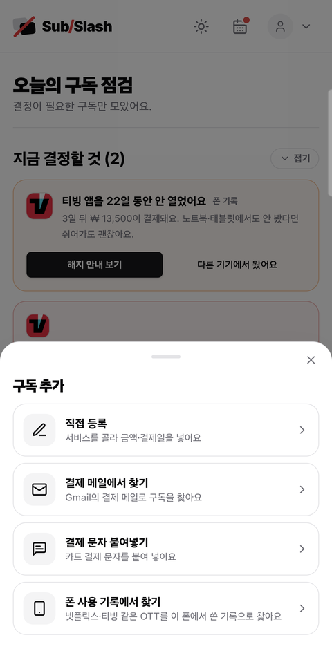
  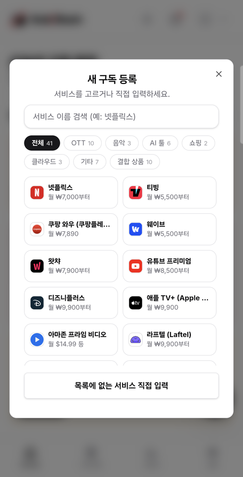
  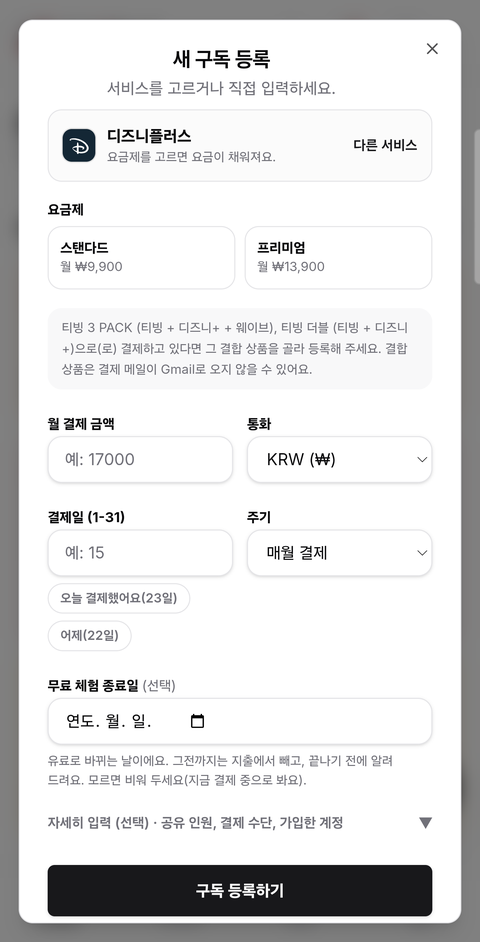
  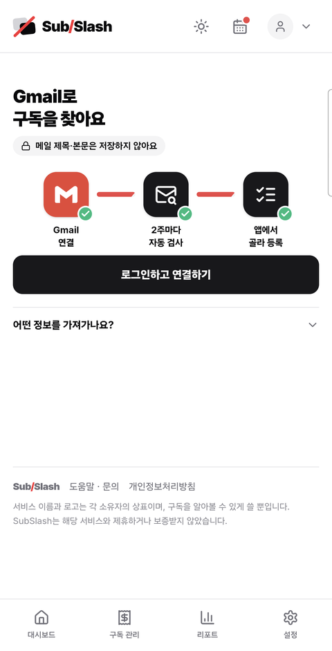

구독 추가 · 서비스 고르기 · 요금제 고르기 · Gmail로 찾기

### 2. 얼마나 썼는지 체크인하기

"지난 30일 동안 몇 번 썼나요?"에 답하면 1회 단가가 나오고, 가성비가 좋은지(초록)·애매한지(노랑)·아까운지(빨강)
색으로 알려 줍니다. 서비스마다 재는 단위가 다릅니다 — OTT는 본 횟수, 멤버십은 받은 혜택, 클라우드 저장 공간은
쓰는 용량처럼요.

직접 세기 어렵다면 대신 세어 주는 방법도 있습니다.

- **안드로이드 앱**은 '사용 정보 접근' 권한을 켜면 구독 앱을 쓴 시간과 횟수를 폰 안에 기록해 체크인을 채워 줍니다.
  기록이 30일을 채우기 전에는 숫자를 적지 않습니다 — 며칠치 기록을 '한 달 동안'으로 적으면 잘못된 판단으로 이어지기
  때문입니다.
- **구글 원(Google One)** 은 내 Google 계정의 저장 공간 사용량을 읽어 몇 %를 쓰는지 채워 줍니다.
- **Claude·ChatGPT 같은 AI 구독**은 PC의 Claude Code·Codex·Cursor·Antigravity 기록이나 claude.ai 대화 내보내기
  파일로 쓴 날을 세고, 같은 사용량을 API로 냈다면 얼마였을지도 보여 줍니다. 파일은 브라우저 안에서만 읽습니다.

  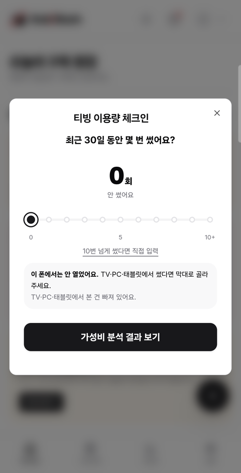
  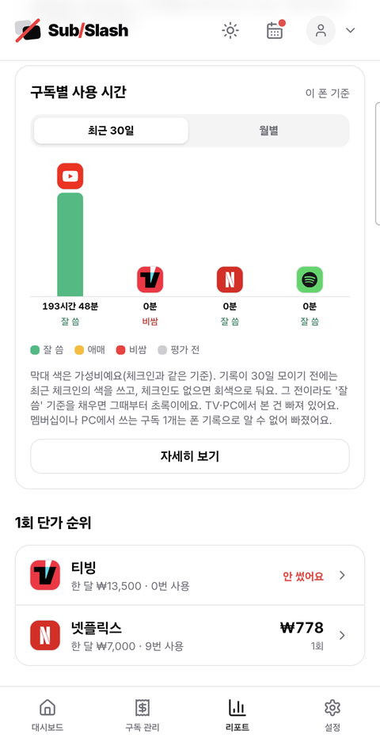

체크인 · 폰 기록으로 본 구독별 사용 시간

### 3. 대시보드에서 할 일 확인하기

대시보드는 지금 신경 써야 할 구독부터 보여 줍니다.

- **해지했는데 또 결제됐어요** — 해지한 구독에 결제 메일이 다시 오면 맨 앞에 올립니다.
- **결제 금액이 달라요** — 결제 메일의 금액이 등록한 금액과 다르면 두 숫자를 나란히 보여 줍니다.
- **무료 체험이 곧 끝나요** — 종료 7일 전부터 알려 줍니다. 체험 중인 구독은 아직 내는 돈이 아니므로 지출 합계에서
  뺍니다.
- **곧 결제돼요 / 체크인할 때가 됐어요** — 결제일이 다가오는 구독, 오래 체크인하지 않은 구독을 알려 줍니다.

  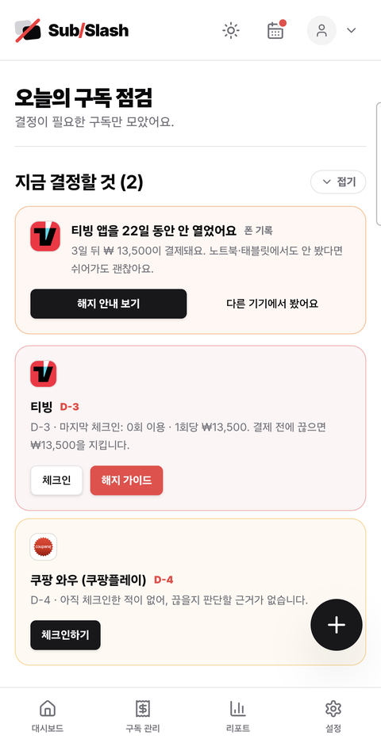
  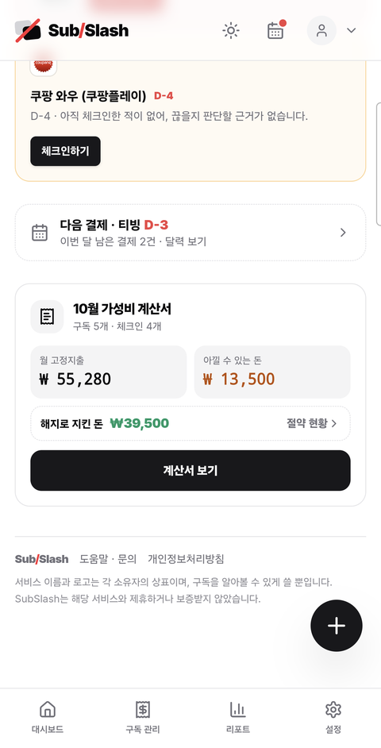
  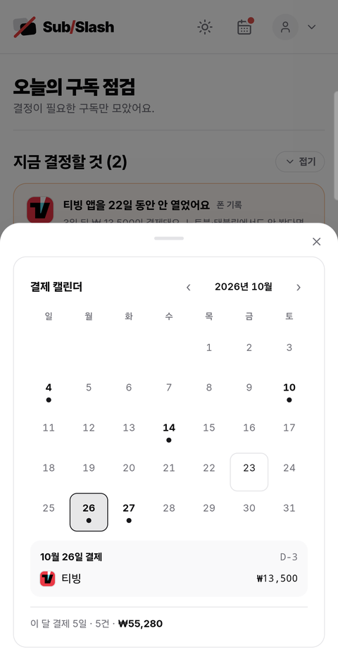

오늘의 구독 점검 · 이달 가성비 계산서 · 결제 캘린더

### 4. 해지하기

해지하기로 했다면 서비스별 해지 방법을 단계별로 안내합니다. 링크가 해지 화면으로 바로 가는지, 서비스 첫 화면까지만
데려다주는지를 구분해 적습니다 — 첫 화면을 열어 놓고 해지된 줄 아는 일이 없도록요. 어느 계정으로 가입했는지 적어
두었다면 "이 계정으로 로그인해야 해지 버튼이 보여요"라고 알려 줍니다.

해지를 기록하면 그만큼 아끼게 된 돈이 **'지킨 돈'** 에 쌓이고, 친구에게 공유할 수 있습니다.

  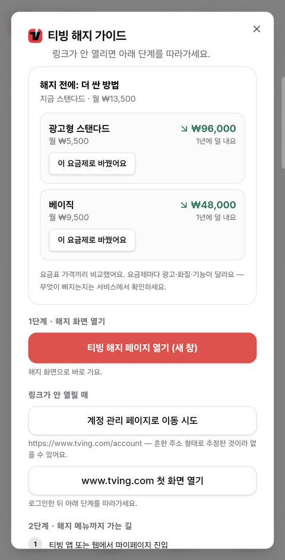
  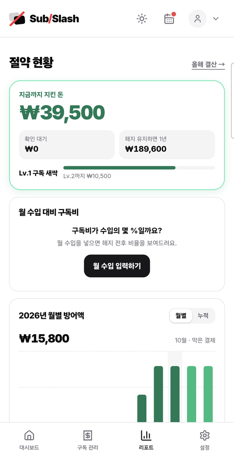

해지 가이드 · 지킨 돈

### 5. 리포트 보기

하단의 **리포트** 탭에서는

- 한 달·1년에 구독으로 나가는 돈과 1회 단가 순위
- 구독별 사용량 그래프(앱은 폰에서 쓴 시간, 웹은 최근 체크인)
- 결합 상품과 단독 구독으로 **같은 서비스를 두 번 내고 있을 가능성**
- **구독 영수증·연말 결산** — 이번 달·올해 낸 구독료를 영수증 모양 이미지로 저장할 수 있습니다(디자인 여러 가지)

을 볼 수 있습니다. **리포트에 물어보기** 칸에 "OTT에 얼마 써?", "넷플릭스랑 멜론 합치면 1년에?"처럼 물으면 바로
답해 줍니다.

  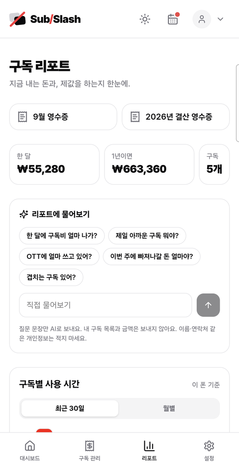
  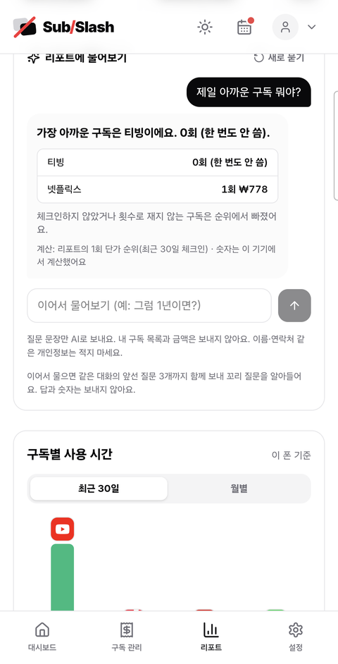
  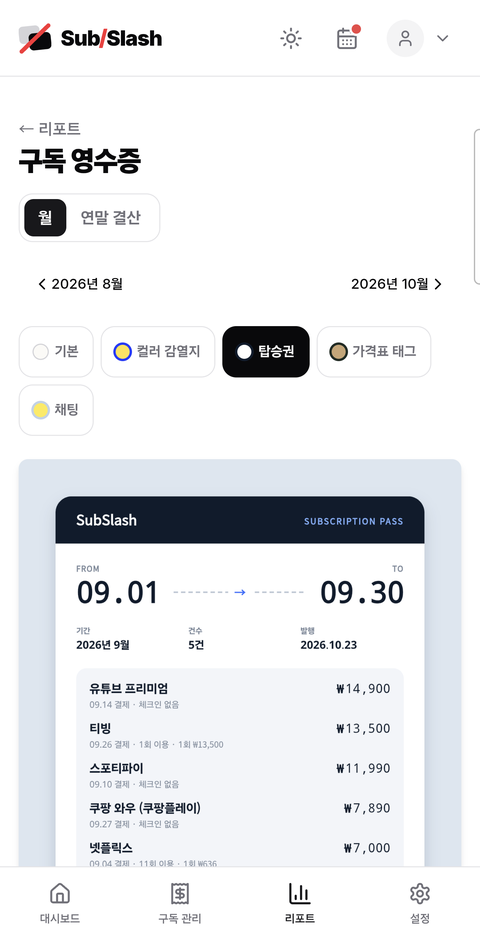

구독 리포트 · 리포트에 물어보기 · 구독 영수증

### 결제일 알림

- 웹: '내 구독' 목록 아래의 **구글 캘린더에 결제일 등록**을 누르면 내 구글 캘린더에 결제일 일정이 생깁니다. 일정 메모에
  해지 주소도 적혀 있어 캘린더에서 바로 해지하러 갈 수 있습니다.
- 앱: 폰 안의 로컬 알림으로 결제 며칠 전에 알려 줍니다. 로그인하지 않아도 됩니다.

## 정확한 숫자를 위해 신경 쓴 것들

- **나눠 내는 구독은 내 몫으로** — 4명이 나누는 가족 요금제를 해지해도 실제로 아끼는 돈은 4분의 1입니다. 지출·절약은
  내가 실제로 내는 몫으로 계산합니다.
- **해외 서비스는 오늘 환율로** — 달러 구독은 매 영업일 고시 환율로 원화를 맞춥니다(직접 정한 환율로 바꿀 수도 있음).
  요금표에 세금이 빠진 서비스는 세금까지 더한 금액으로 보여 줍니다. 지난 결제를 보여 주는 영수증은 그 결제일의 환율로
  바꿉니다.
- **모르는 건 모른다고** — 결제 월을 모르는 연간 구독에 날짜를 지어내지 않고 '결제 월 미설정'으로 보여 줍니다.
  알아보지 못한 결제는 그럴듯한 이름을 붙이지 않고 '알 수 없는 결제'로 둡니다.

## 내 정보는 어디에 저장되나요?

- **기본은 내 기기 안입니다.** 로그인하지 않으면 구독 기록은 브라우저(앱은 폰) 안에만 있고 서버로 가지 않습니다.
- **로그인하면** 기록이 계정에 저장되고 여러 기기에서 같은 기록을 볼 수 있습니다. 이메일·아이디로 가입하거나 구글·
  카카오·네이버로 로그인할 수 있습니다. 기기마다 자동 동기화를 끌 수 있습니다.
- **Gmail에서 찾기**는 내 Google 계정에서 도는 스크립트가 메일을 읽습니다. SubSlash 서버에는 메일 제목·본문을 남기지
  않고, 찾아낸 구독 후보만 잠시 둡니다.
- **리포트에 물어보기**는 AI에 질문 문장만 보냅니다. 구독 목록과 금액은 보내지 않고, 숫자는 기기가 직접 계산합니다.
  흔한 질문은 AI를 거치지 않고 기기 안에서 바로 답합니다.
- **폰 사용 기록**은 폰 밖으로 나가지 않습니다.
- 언제든 설정에서 백업 파일로 내보내거나 전체 기록을 지울 수 있습니다.

자세한 내용은 [개인정보처리방침](https://www.subslash.me/privacy)에 있습니다. 궁금한 점은 앱의
[도움말](https://www.subslash.me/help)에서 찾아보거나 `privacy@subslash.me`로 문의해 주세요.

## 그 밖에

- **화면 언어**: 한국어·영어·중국어(간체)·일본어·베트남어·프랑스어·스페인어·독일어·포르투갈어. 요금은 한국에서
  확인한 원화 기준입니다.
- **화면 모드**: 상단 바에서 자동·라이트·다크를 고를 수 있습니다.
- 만 14세 이상부터 가입할 수 있습니다.
- 결제 알림 메일과 캘린더 구독 피드(webcal)는 2026년 10월에 그만뒀습니다. 결제일은 위의 구글 캘린더 등록이나 앱
  알림으로 받아 주세요.

## 개발자라면

코드를 내려받아 실행하고 배포하는 방법은 [개발 안내](docs/DEVELOPMENT.md)에, 코드를 고칠 때 지킬 규칙은
[CLAUDE.md](CLAUDE.md)에 있습니다.

## 라이선스

소스 코드는 [MIT](LICENSE)입니다.

**서비스 로고와 이름은 MIT가 덮지 않습니다.** `apps/web/public/logos/`의 앱 아이콘과
`apps/web/lib/service-logos.ts`의 브랜드 글리프, 그리고 앱에 나오는 서비스 이름은 각 소유자의 상표이며, 이용자가
구독 중인 서비스를 알아볼 수 있게 하려고 쓸 뿐입니다. 자세한 내용과 삭제 요청 방법은 `LICENSE` 아래쪽에 있습니다.
